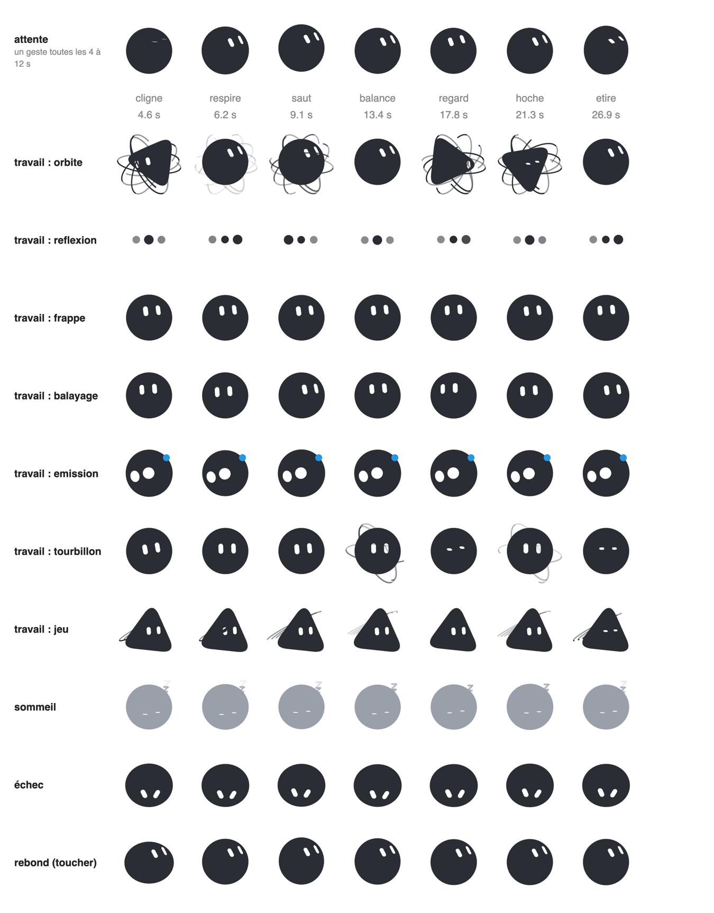
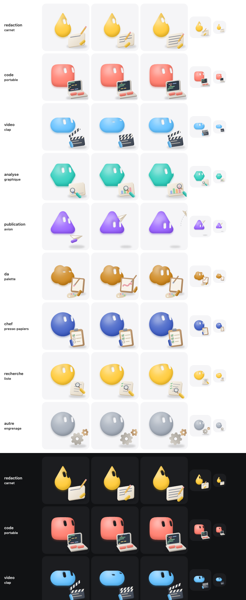

# bloub

An SVG recreation of the x.ai bot avatar: **one filled black shape** that morphs
between 14 states, **two white shapes** for the eyes that morph independently, on
a plain background. No animation library.


## Running it

```bash
pnpm install
pnpm dev
```

Then open http://localhost:5190.

```bash
pnpm test     # vitest
pnpm build    # vue-tsc --noEmit && vite build
```

Vue 3, Vite, TypeScript, Tailwind 4. No ESLint and no Prettier: `vue-tsc` is the
only gate, so run `pnpm build` before you call something done.

## What's in it

The rail on the left switches between three views. **Customise** offers 8 body
shapes, 12 colours, 16 rest expressions and 4 render styles (original, pixel art,
3D clay, 3D bubble), kept between visits. **Animations** is
a small editor: arrange states into a timeline, set how long each is held, save the
result. **Settings** holds the language (French, English or Chinese) and the
credits.

Anything on screen can be exported: the avatar as SVG, PNG or an animated GIF, and
a whole timeline as GIF or MP4. The still formats need no library at all, and the
video encoder is only fetched the first time you ask for one.

Two URLs are worth knowing:

- `#planche`: the 14 states side by side, frozen. Quick visual check.
- `#etat=orbit&stop`: opens one state directly, playback paused.


### Gestures (optional layer)

`src/bot/gestes.ts` adds small, seeded animations on top of the measured poses, so a
group of avatars doesn't move as one: varied idle gestures every 4 to 12 s (blink,
breath, hop, sway, look around, nod, stretch) with a per-seed personality, a bounce on
touch, sleep and failure postures, and seven "working" activities built on the engine's
states. They only apply when passed to `engine.sample(t, geste)`; without one, the frame
is byte-identical. Details (in French) in [docs/gestes.md](docs/gestes.md).



### Job accessories (optional layer)

`src/bot/accessoires.ts` gives a working avatar a small animated prop drawn in code, in the
matte clay style: a notebook and a pencil writing line by line, a laptop with scrolling
coloured code and typing hands, a clapperboard, a bar chart under a magnifier, a paper
plane that leaves and comes back, a canvas and a brush, a clipboard ticking itself, a
list read with a magnifier, a gear. Each prop comes with a gesture (the avatar steps
aside and looks at it). `dessin(t, options)` returns SVG text in the engine's frame;
`simple: true` drops fine details for tiny sizes. Details (in French) in
[docs/accessoires.md](docs/accessoires.md).



## Why the numbers look arbitrary

They're measured, not chosen. The reference video was cut at 10 fps and each
state measured off the frames: silhouettes by sub-pixel ray casting, eyes by
capsule fitting, colours and stroke widths by direct sampling.

So the constants in the code are **measurements**, and rounding them to friendlier
values breaks the resemblance, which is the only thing this project is trying to
get right. A few are counter-intuitive enough to be worth knowing before you
correct anything:

| What you'd assume | What the video shows |
|---|---|
| The eyes lean `//` | They lean `\\`, around 26° off vertical |
| The body is a squircle | It's a perfect circle, radial deviation under 0.7% |
| Transitions are springs | Exponential ease-outs; the body never overshoots |
| The comet crosses the screen | The dot stays put, the trail orbits it |
| The avatar floats at rest | It doesn't. The life is gaze drift and blinking |

[docs/measurements.md](docs/measurements.md) has the rest, including how to
regenerate the extracted profiles.

## How it's put together

`src/bot/` is framework-free and clock-free: `engine.sample(t)` is a pure
function of time. Pausing, resuming, jumping to an arbitrary date and running
tests all produce the same image, which is what makes the frozen state board and
the DOM-less test suite possible.

| | |
|---|---|
| [docs/architecture.md](docs/architecture.md) | The engine, radial-profile morphing, eyes as mask holes |
| [docs/measurements.md](docs/measurements.md) | What was measured, and regenerating `profiles.ts` |
| [docs/intro.md](docs/intro.md) | The arrival sequence, and why it only plays one state |
| [docs/interface.md](docs/interface.md) | Layout, the three-column scene, CSS traps |
| [docs/export.md](docs/export.md) | Exporting to SVG, PNG, GIF and MP4 |
| [docs/i18n.md](docs/i18n.md) | The hand-rolled translation layer |
| [docs/styles.md](docs/styles.md) | Render styles: pixel art, soft 3D (clay, bubble) |

## Using the component

```vue
<BloubBot v-model:block="block" v-model:state="state" v-model:playing="playing" />
<BloubBot state="orbit" :size="120" :frozen-at="1.2" />
```

`block` is the playback cursor: a montage can play the same state twice, so the
index is what identifies where you are; `state` follows it as an output. Pass
`frozenAt` and the component renders one exact frame with no animation loop, which
is how the thumbnails and the state board are drawn.

Props: `size`, `shape`, `color`, `expression`, `paper`, `frozenAt`, `cycle`,
`follow`, `gaze`. Models: `block`, `state`, `playing`, `elapsed`. See
[BloubBot.vue](src/components/BloubBot.vue) for the details.

## Changes

[CHANGELOG.md](CHANGELOG.md), one entry per release — which is how you tell whether the
copy you have carries a given fix.

## License

MIT. See [LICENSE](LICENSE).

Not affiliated with, endorsed by or connected to x.ai. It recreates the visual
behaviour of their bot avatar as an exercise; "Grok" and "x.ai" belong to their
owners. The MIT licence covers the code in this repository, not the design it
imitates.
